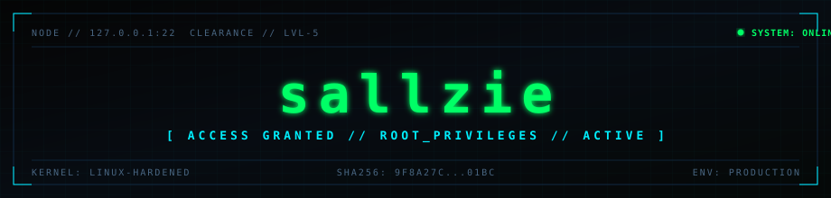

<p align="center">
  
</p>

<!-- 
  [OPTIONAL EXTERNAL BANNER FALLBACK]:
  Jika repo tidak menyertakan folder assets, gunakan URL eksternal berikut pada src gambar di atas:
  https://capsule-render.vercel.app/api?type=rect&color=050505&height=180&text=sallzie&fontSize=64&fontColor=00FF66&fontAlignY=45&desc=%5B%20ACCESS%20GRANTED%20%2F%2F%20ROOT_PRIVILEGES%20%2F%2F%20ACTIVE%20%5D&descSize=13&descAlignY=68&descColor=00F0FF
-->

```bash
$ whoami --verbose
OPERATOR     : sallzie (UID: 0)
SYSTEM       : Linux 6.x-hardened // x86_64
CLEARANCE    : LEVEL-5 (SECURITY_OPERATIONS)
DISCIPLINE   : Offensive Security // Vulnerability Research // Systems Hardening
CORE_TARGETS : Web Application Security (OWASP Top 10) • Network Forensics • Exploit Development
STATUS       : ACTIVE // DEPLOYED
```

---

### [01] ARSENAL & TOOLING

<table>
  <tr>
    <td width="25%"><strong>Offensive / Defense</strong></td>
    <td>
      
      
      
      
      
    </td>
  </tr>
  <tr>
    <td><strong>Languages / Scripting</strong></td>
    <td>
      
      
      
      
      
    </td>
  </tr>
  <tr>
    <td><strong>Infrastructure / Ops</strong></td>
    <td>
      
      
      
      
      
    </td>
  </tr>
</table>

---

### [02] TELEMETRY & ACTIVITY

<div align="center">
  <table border="0">
    <tr>
      <td align="center" width="50%">
        
      </td>
      <td align="center" width="50%">
        
      </td>
    </tr>
  </table>

  <p>
    
  </p>
</div>

---

### [03] PLATFORMS & VERIFICATION

<div align="center">
  <!-- EDIT DI SINI: Sesuaikan username/link profil Anda -->
  <a href="https://tryhackme.com/p/salmanalfarisiprib-spec" target="_blank">
    
  </a>
  &nbsp;
  <a href="https://app.hackthebox.com/profile/salmanalfarisiprib-spec" target="_blank">
    
  </a>
  &nbsp;
  <a href="https://portswigger.net/web-security" target="_blank">
    
  </a>
</div>

---

### [04] SECURE COMMS & SIGNATURES

<div align="center">
  <!-- EDIT DI SINI: Masukkan link profil & email aktif Anda -->
  <a href="https://linkedin.com/in/salmanalfarisiprib-spec" target="_blank">
    
  </a>
  &nbsp;
  <a href="mailto:salmanalfarisi@example.com">
    
  </a>
  &nbsp;
  <a href="https://github.com/salmanalfarisiprib-spec" target="_blank">
    
  </a>
</div>

<br/>

<details>
  <summary><strong>[+] PGP KEY FINGERPRINT</strong></summary>

```text
-----BEGIN PGP PUBLIC KEY BLOCK-----
Comment: Operator Identity Verification Key (sallzie)

pub   rsa4096/0x8F2A90C45DE701BC 2026-01-01 [SC]
      Fingerprint: 98F1 2A3B C45D 678E F012  3456 789A BCDE F012 3456
uid   [ultimate] sallzie (Security Operations) <salmanalfarisi@example.com>
sub   rsa4096/0x4C873D1E2A90F811 2026-01-01 [E]
-----END PGP PUBLIC KEY BLOCK-----
```
</details>

<br/>

```text
[EOF] // HASH: SHA-256: 8a4f91b72e5dc...c08 // TERMINAL SESSION CLOSED
```
